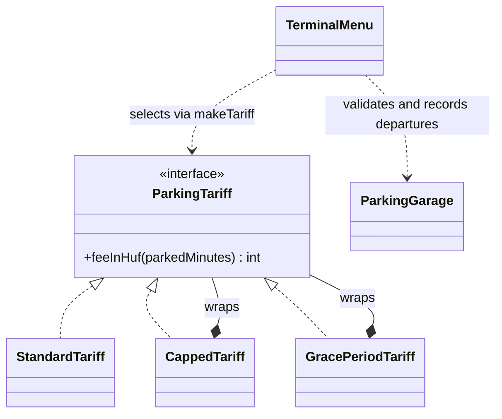

# Parking Garage Manager

A C++ command-line application for tracking vehicle entry, exit, and parking fees. The program keeps parking records in memory for the current session.

## Entry and exit

- The garage has 10 spaces. Entry is rejected when the garage is full or the vehicle's license plate is already registered.
- For each successful entry, the garage records the arrival time entered in 24-hour `HH:MM` format.
- On exit, enter the license plate and a departure time on the same day. After these are validated, choose a tariff to complete the departure, display the fee, and free the space. Press Enter at the tariff prompt to cancel the departure.

## Tariffs

- **Standard** charges 400 HUF per started hour.
- **Capped** applies the standard rate with a maximum of 1,200 HUF per stay.
- **First 15 minutes free** deducts 15 minutes from the stay, then applies the standard rate to any remaining time. A 15-minute stay costs 0 HUF and a 16-minute stay costs 400 HUF.

## Design decisions

- **Strategy** keeps fee rules behind the `ParkingTariff` interface. The exit flow only needs a duration and the selected strategy.
- **Factory** centralizes tariff construction in `makeTariff()`. Adding a tariff involves implementing or composing a strategy and exposing it as a factory and menu choice. Entry, departure validation, and capacity management use the same garage logic.
- **Decorator and dependency injection** let `CappedTariff` and `GracePeriodTariff` wrap a tariff supplied through their constructors. The factory supplies `StandardTariff` for both menu choices, while tests can combine the decorators to demonstrate that the rules are composable.
- **Exit validation** runs before tariff selection. An invalid or cancelled departure leaves the parking record available for a later attempt.



`TerminalMenu` represents the functions in `main.cpp`.

## Garage status

Choose `3` to see the available spaces and the parked vehicles. The list shows each license plate and arrival time in license plate order.

## Build, run, and test

Use CMake 3.24 or newer and a C++17 compiler. Run the commands from the repository root. On a fresh configuration with tests enabled, CMake downloads Catch2 3.8.1 and checks the archive against its pinned SHA-256 hash. To build without the test dependency, use `cmake -S . -B build/app -DBUILD_TESTING=OFF` followed by `cmake --build build/app`.

### Windows with Visual Studio Build Tools

Open a Visual Studio Developer Command Prompt with the C++ workload installed.

```bat
cmake --preset debug
cmake --build --preset debug
build\debug\Debug\parking-garage-manager.exe
ctest --preset debug
```

### Linux

```sh
cmake --preset debug
cmake --build --preset debug
./build/debug/parking-garage-manager
ctest --preset debug
```

GitHub Actions builds with compiler warnings enabled and runs the Catch2 cases through CTest on Ubuntu 24.04. A second job uses Clang with AddressSanitizer and UndefinedBehaviorSanitizer. To run the sanitizer configuration on Linux with Clang:

```sh
CXX=clang++ cmake --preset sanitizers
cmake --build --preset sanitizers
ctest --preset sanitizers
```

## Example session

1. Choose `1` and enter `ABC-123` at `09:00`.
2. Choose `3` to see the vehicle and the nine available spaces.
3. Choose `2`, enter `ABC-123` and `13:00`, then choose the capped tariff. The fee is `1200 HUF` for `240` minutes.
4. Choose `3` again to confirm that the garage has ten available spaces.

## AI assistance

OpenAI Codex assisted with implementation, refactoring, test cases, CMake and CI configuration, and documentation. The project was checked with local builds, automated tests, and command-line scenarios. The fee rules and edge cases are documented above so the results can be reviewed and reproduced.
